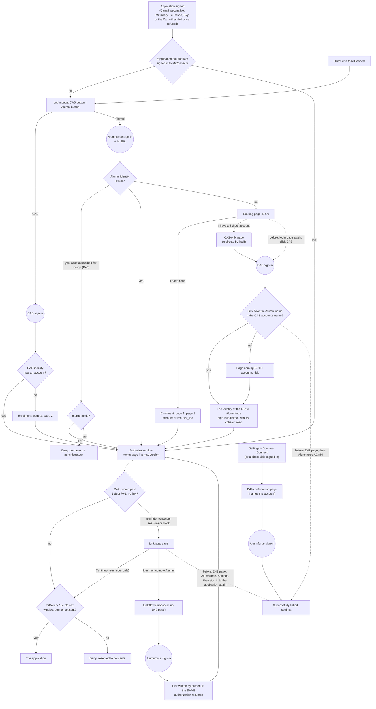

# MiConnect sign-in paths: every way in, and what each one asks (2026-11-25)

The owner's request of 2026-11-25: someone who signs in with Alumni, then says they have a School
account, had to sign in with Alumni AGAIN. *"Le but est de ne pas avoir à se connecter plusieurs
fois, et avoir l'expérience la plus fluide possible. Trace tous les cas possibles sur un diagramme,
et corrige toutes ces redondances."* This page is that diagram, the count of what each path asks
before and after the fix, what was fixed and why it is safe, and what is still left.

The blueprints are in `infrastructure/authentik/blueprints/` and the mechanisms are on
[authentik](authentik.md#the-alumni-sso-as-built-for-180-d42-d49-owner-2026-11-23). The decisions
they implement (D42-D51) are on [profiles-and-access](../profiles-and-access.md).

## The diagram

Every application (Canari web and native, MiGallery, Le Cercle, Sky, the wiki, the archives) starts
the same way: an OIDC authorization at `/application/o/authorize/`. The Canari sign-in handoff to
Sky, MiGallery and Le Cercle, when core-service refuses it (`alumni_link_required`,
`alumni_cotisant_required`), opens the site through that same authorization. The diagram shows the
paths AFTER the fix; the dashed edges are what was removed.

## Every path, counted

A = an Alumnforce sign-in (with Alumnforce's own second factor), C = a CAS sign-in (silent when the
CAS session is still alive), "pages" = MiConnect pages that ask a click, "ends" = where the person
lands. Pages that ask something new (the terms of a new version, the enrolment pages, the routing
choice, a deny) are counted only where they changed.

| # | Entry, state, button | Before: prompts / extra pages / ends | After: prompts / extra pages / ends |
| --- | --- | --- | --- |
| P1 | App, signed out, CAS, linked or CAS-only account, no D44 due | C / - / app | unchanged |
| P2 | App, already signed in to MiConnect | - / - / app | unchanged |
| P3 | App, signed out, Alumni, account already linked (CAS+Alumni or `alumni-`) | A / - / app (or the cotisant deny) | unchanged |
| P4 | App, signed out, Alumni, duplicate marked for merge (D48) | A / - / the target in the app, or the deny page | unchanged |
| P5 | App, signed out, Alumni, no link, "I have none" | A / routing, 2 enrolment pages / app | unchanged (each page asks something new) |
| **P6** | **App, signed out, Alumni, no link, "I have a School account"** (the owner's case) | **A, C, A / routing, the login page AGAIN (click CAS), D49 tick, Settings, back to the app, sign in again / Settings** | **A, C / routing / app** when the names agree; **A, C / routing, one page naming both / app** when they differ |
| P7 | P6, the CAS identity has no MiConnect account yet | P6 + 2 enrolment pages | P6 after + 2 enrolment pages, ends in the app |
| **P8** | **App, CAS, D44 reminder due** (once per session) | **C, A / reminder, D49 tick, Settings, back to the app, sign in again / Settings** | **C, A / reminder / app** |
| **P9** | **App, CAS, D44 block due** | **C, A / block, D49 tick, Settings, back to the app, sign in again / Settings** | **C, A / block / app** |
| P10 | Canari handoff refused `alumni_link_required` | becomes P9 through the site's own sign-in | P9 after |
| P11 | Settings > Sources "Connect" (signed in) | A / D49 tick / Settings | unchanged: Settings is where the person started, and D49 asks this page |
| P12 | Direct visit to `/source/saml/alumni/`, signed in | A / D49 tick / Settings | unchanged |
| P13 | Direct visit to MiConnect, signed out | C or A / - / Canari (the brand's rule) | unchanged |
| P14 | MiGallery or Le Cercle after the window, not cotisant this year | A or C / - / deny | unchanged (an answer, not a redundancy) |

The native app gains the most from P8-P9: the authorization runs in the system's authentication
browser, which before stayed on MiConnect's settings page; it now ends on the app's redirect URI.

## What was fixed, and why each is safe

**1. The routing page links the identity Alumnforce already asserted (P6-P7; owner's decision of
2026-11-25, option 1, [decisions](../decisions/owner-decisions-of-2026-11-25.md)).** When the person
picks "I have a School account", the enrolment plan holds the identity authentik took from the
VERIFIED assertion of that sign-in (`PLAN_CONTEXT_SOURCES_CONNECTION`, not yet saved), the two names
and the membership read. The routing policy (`miconnect-enrollment-alumni-chose-cas`,
`20-enrollment.yaml`) PARKS them server-side in the session (`miconnect/alumni-link-parked`). After
the CAS sign-in the link flow (`miconnect-alumni-link`, `30-sources.yaml`) takes them out of the
session and links them to the account the CAS signed in: at once when the asserted name equals the
account's name, folded by `miconnect-alumni-names-agree` - the ONE comparison, which the D51 merge
now calls too (`ak_call_policy`) - and otherwise after a page naming BOTH accounts and a tick. The
membership read of that assertion is written with the link (D43); before, a link wrote none, and
`cotisant` waited for the next Alumni sign-in. Then the flow ends on the authorization the person
started. No second Alumnforce sign-in, no D49 page.

**2. The link step resumes the application's sign-in (P8-P10).** authentik resumes a flow after a
source with its Enterprise Source stage, which MiConnect cannot build (no licence). But the
mechanism that stage relies on is in authentik's CORE: `SourceFlowManager.handle_existing_link`
(`core/sources/flow_manager.py:397-400`, 2026.8.6) hands a signed-in link to `_prepare_flow(None)`
when the session holds a flow token under `SESSION_KEY_OVERRIDE_FLOW_TOKEN`; that restores the
token's plan, appends authentik's own `PostSourceStage` (which writes the connection on the plan's
pending user) and ends the flow on the `next` the person came with (`flow_manager.py:304-339`). When
the D44 step proposed the link, the pre-authentication flow's policy
(`miconnect-alumni-link-unconfirmed`) plans the small flow `miconnect-alumni-link-done` for the
account signed in now and puts its token in the session. Alumnforce answers, authentik writes the
link, and the flow redirects to the authorization, which now passes and gives the application its
code. Here Alumnforce IS asked: the person signed in through the CAS and has not proven the Alumni
identity in this session.

**3. Where the person came from travels with them.** The link step's link and the routing page's
return both go to the link flow with the authorization as `next`; the flow executor stores it in the
session, where the link flow's end, the Alumni source's entry (`sources/saml/views.py:75-82`) and
its ACS (`:174-178`) read it. The link step's page builds its link from the authorization's own
query (the flow's stored GET); the routing policy reads the enrolment plan's `redirect`, which
authentik filled from the same `next`.

**4. The routing page goes straight to the CAS (P6).** It used to send the person to the login page
again, with both buttons. It now targets `miconnect-auth-cas`, whose identification stage lists the
CAS alone and no field: authentik's own login page sends the browser to a lone source by itself
(`web/src/flow/stages/identification/controllers/AutoRedirectController.ts`: one source, no user
field, no passwordless flow). The redirect stage's target is set by its policy
(`redirect_stage_target`), with the link flow as `next`.

**5. No D49 page for the link step (P8-P9).** D49 is, in the owner's words, "every link outside the
D44 step"; as built it showed on the step's link too, because a marker in a URL would be read at
plan time. It is now a server-side session marker: the D44 policies, when their page is due, write
an OFFER (`miconnect/alumni-link-offered` = the account's pk); the link flow turns it into the
PROPOSAL (`miconnect/alumni-link-proposed`) the pre-authentication policy consumes. Settings >
"Connect" and any direct visit still meet the page and still end on the settings, as authentik ends
them.

### The security boundary (a change to how a source connection is created)

**What changed.** Two ways now write an Alumni connection besides authentik's own signed-in link:
(a) the parked identity, written by `miconnect-alumni-link-parked-write` after the CAS sign-in, with
no Alumnforce answer in between; (b) the resumed link, written by authentik's `PostSourceStage` on
the resume token's pending user instead of on `request.user` read at the ACS. And the D49 page is
skipped for the link step.

**What holds, and what stops each threat:**

- **The identity is always one Alumnforce asserted in THIS session**, signed (`signed_response`,
  `signed_assertion`) and answering a request this session issued (`allow_idp_initiated: false`). The
  parked record is written only by a policy, from the plan's source connection authentik built from
  that assertion, into the server-side session; nothing a browser sends reaches it. The first link
  flow that runs takes it out of the session (single-use), and honours it only for a signed-in,
  non-impersonated session with a `next` on MiConnect.
- **Attaching someone else's Alumni identity to one's own account** needs a signed assertion for that
  identity answering this session's request: unchanged.
- **Attaching one's own Alumni identity to someone else's account.** Through the parked record: only
  when that someone signs in with the CAS in the SAME browser session before the record is used (a
  shared computer left after "I have a School account"). Then the names decide: a different name
  meets the page naming BOTH accounts, which that person refuses or closes; **a homonym is linked
  with no page - the residual risk the owner accepted** (2026-11-25). Before this change the second
  Alumnforce sign-in proved the identity again; the owner traded it for the fluid path. Through the
  resume token: it is created only for the account the session holds at that moment; a session
  cannot change account without being flushed, and the done flow re-checks it (same account, Alumni
  source, no existing link, a redirect on MiConnect) before authentik writes; otherwise the deny page
  and nothing written (`failure_result: true`: an error denies too). The token is single-use, and any
  token is removed by every link that was not proposed.
- **Two links for one identity or one account.** The parked write locks the account row and refuses
  when the account already holds an Alumni link or the identity is linked elsewhere (another tab):
  the deny page, nothing written. The link, its membership read and its `source_linked` Event are
  one transaction.
- **Skipping D49 by a crafted link.** Nothing in a URL makes a proposal. The link flow proposes only
  when the session already holds an offer for that account, consumes it at once, and refuses a
  `next` that leaves MiConnect. A lured visit meets the D49 page, as before.
- **An open redirect through `next`.** authentik's `_flow_done` redirects to a plan's `redirect`
  unchecked; the link flow and the done flow refuse anything but a path on MiConnect, and the routing
  policy drops it.

`test-consent-flow.py` steps 10-12 drive each of these on a throwaway authentik, from a real
authorization to the application's code (only the IdP round trips are emulated, by authentik's own
`SourceFlowManager.get_flow` on the browser's session): names that agree (no page, linked, the read
stored), names that differ (the page naming both, nothing without the tick, linked with it), an
identity linked elsewhere meanwhile (refused), the link step (one Alumnforce answer, the same
authorization), and the boundary cases. `test-enrollment-flow.py` step G checks the routing target
and the parked identity, step M the merge through the shared comparison.

**An abandoned first attempt (read on production 2026-11-25).** The enrolment page was served after
the ACS, its executor was never called, and the browser went back to the pre-authentication page,
which dropped the plan and cost a whole Alumnforce sign-in. Nothing in the enrolment page runs before
its first executor call: it is authentik's static flow interface, which calls the executor as soon as
its script loads, and the routing page is the plan's first stage, decided at that call. The back
button discarding a plan is authentik's executor (a plan for another flow is cancelled), not
something a blueprint can keep.

## What remains impossible, and its cost

- **A link from the settings page or from the link step writes no membership read**: authentik
  passes no assertion properties to a signed-in link (`handle_existing_link`), so `cotisant` is first
  read at the next Alumni sign-in. The routing path now writes it (above); it matters only after the
  free window.
- **The homonym on a shared computer** (above): the owner's accepted residual risk of option 1.
- **An authorization carrying `prompt=login` or an exceeded `max_age`** would ask for a sign-in again
  when resumed: authentik's authorize view decides that (`providers/oauth2/views/authorize.py`). No
  MiConnect client sends either (read 2026-11-25).
- **The resume relies on authentik internals** (`SESSION_KEY_OVERRIDE_FLOW_TOKEN`, `FlowToken`,
  `PostSourceStage`, `_prepare_flow(None)`), core code, not Enterprise. An authentik upgrade that
  changes them turns `test-consent-flow.py` steps 10-12 red before any release applies it; the
  other way would be the Enterprise Source stage ([authentik](authentik.md#the-alumni-sso-as-built-for-180-d42-d49-owner-2026-11-23)).

Readings owed on production with a real Alumni account:
[the entry](../backlog.d/reading-owed-miconnect-one-sign-in-per-path.md).
